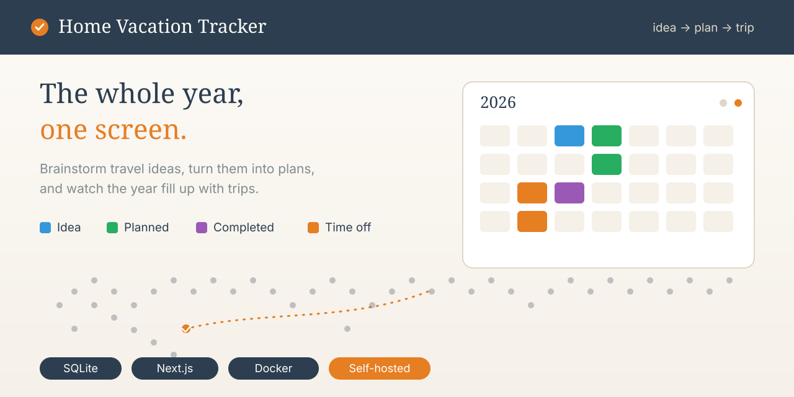

# Home Vacation Tracker

A small, self-hosted travel planner for a household. It turns trip brainstorming into a simple flow — **Idea → Plan → Completed trip** — with a bird's-eye view of the whole year.



## What it does

- **Travel ideas** — capture destinations, dates, trip type and a rough budget while they are still dreams.
- **Trip plans** — turn an idea into a concrete plan with real dates and a status (planned / reserved / completed).
- **Completed trips** — keep the memories; see everything you have done at a glance.
- **Annual calendar** — one screen with the whole year: planned trips, completed trips and each person's work days off.
- **World map** — an interactive map colouring every country by trip status, with details on click.
- **Time off** — track work vacation days for two people so plans fit around real availability.

Everything is stored locally in a single SQLite file — no cloud account, no external services.

## Tech stack

- [Next.js](https://nextjs.org) (App Router) + React + TypeScript
- [Tailwind CSS](https://tailwindcss.com)
- SQLite via [better-sqlite3](https://github.com/WiseLibs/node-sqlite3)
- [react-simple-maps](https://www.react-simple-maps.com) + world-atlas TopoJSON
- [Lucide](https://lucide.dev) icons

## Getting started

### Development

```bash
npm install
npm run dev
```

Open http://localhost:3000.

### Production with Docker

```bash
npm run build
docker build -t home-vacation-tracker .
docker run -d -p 3100:3100 -v ./data:/app home-vacation-tracker
```

The SQLite database (`tracker.db`) is created automatically on first run.

### Customising the two people

Labels and colours for the two people live in one place: [`lib/people.ts`](lib/people.ts).

## Project structure

```
app/                  Pages and API routes
  page.tsx            Home: annual calendar + world map + summary
  ideas/              Travel idea list and forms
  plans/              Trip plan list and forms
  completed/          Completed trips
  time-off/           Work days off per person
  api/                REST endpoints (ideas, plans, work-vacations, countries)
components/
  features/           AnnualCalendar, WorldMap, IdeaCard, PlanCard, selectors
  layout/             Header, Sidebar
  ui/                 Button, Card, Input, Select, Textarea, Modal
lib/                  db.ts (SQLite), types.ts, utils.ts, people.ts
public/data/          countries.json, cities.json, world-atlas.json
docs/banner.svg       Project banner
SPEC.md               Design & technical specification
```

## License

[MIT](LICENSE) — use it, change it, share it.
